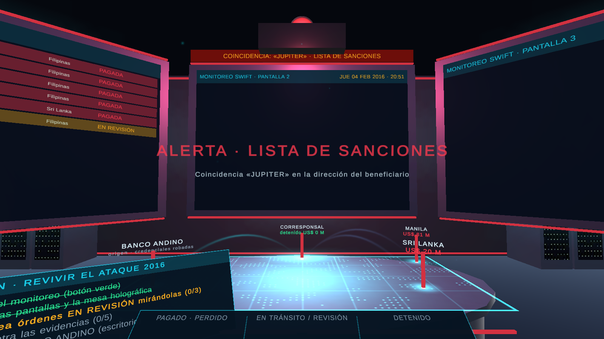

# ANDES-SIM · Escenario 05 · Banco Corresponsal Internacional (VR)

Juego de realidad virtual para **Google Cardboard** (Android) del curso de Realidad Virtual y Aumentada ·
Caso **BANCO ANDINO**. Basado en el robo al Banco de Bangladesh (2016), con **bancos y personas ficticios**.
Solo simulación y defensa.

## Entregables

| Qué | Dónde |
|---|---|
| **APK** para instalar en el celular | [`Entrega/AndesSim_E5.apk`](Entrega/AndesSim_E5.apk) |
| **Diapositivas** de la exposición (PDF) | [`Diapositiva/`](Diapositiva/) |
| **Video narrado** (2:37) | Drive del curso · el proyecto que lo genera está en [`Video/`](Video/) |
| Capturas del juego | [`Docs/capturas/`](Docs/capturas/) |
| Proyecto Unity 6 | `Assets/`, `Packages/`, `ProjectSettings/` |

**Instalar:** descargar el APK en un Android, permitir «instalar apps de origen desconocido», abrir y
colocar el celular en el visor Cardboard. Se juega con la mirada (la retícula selecciona al mirar fijo).

## La historia

Jueves 4 de febrero de 2016, de noche. Llegan 36 órdenes SWIFT por **US$ 951 M** a nombre del BANCO ANDINO,
enviadas en realidad por el grupo criminal Lazarus. Una alerta salta porque la calle receptora se llama
**«JUPITER»**, como un petrolero de una lista de sanciones: se congelan 30 órdenes, pero **5 ya se pagaron
(US$ 101 M)**. Llaman al banco para confirmar y nadie contesta: es fin de semana.

- **Modo Ataque (2016):** el teléfono suena sin respuesta → se pierden US$ 101 M.
- **Modo Defensa:** contactos 24/7, llamada a número registrado y reglas por destino y monto →
  la llamada se confirma, las 5 órdenes pagadas pasan a retenidas → **US$ 0 perdidos**.

Flujo: Portal → ascensor → pantallas de monitoreo → alerta «Jupiter» → bloquear órdenes con la mirada →
evidencias (lupa «FANDATION») → llamada al banco → resultado → análisis.

## Requisitos del curso

Unity 6 · APK Android · modo Ataque y Defensa en la misma app · portal de entrada · teletransporte por
mirada (sin movimiento continuo) · más de 5 objetos interactivos con la retícula · sonido 3D · pantalla
final con el dinero salvado · créditos dentro de la app con las IA usadas.

## Equipo

- **Meza Miranda Jhosue Alejandro** · líder, ciberseguridad y QA
- **Limache Cunyas Noemi Cielo** · desarrollo Unity (C#)
- **Castro Inga Anyeli Eliana** · arte 3D, UI y sonido

## Herramientas y créditos

Unity 6000.0 · Cardboard XR Plugin · TextMeshPro · Blender 5.3 (modelos propios) · modelos «Furniture Kit»
de Kenney (CC0) · sonidos de Freesound (CC0, autores en los créditos del juego).
**IA usadas:** Claude Code (Anthropic) y Google Antigravity. Voz del video: Kokoro (IA local).
